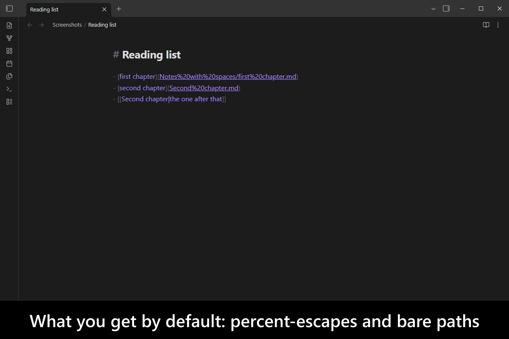
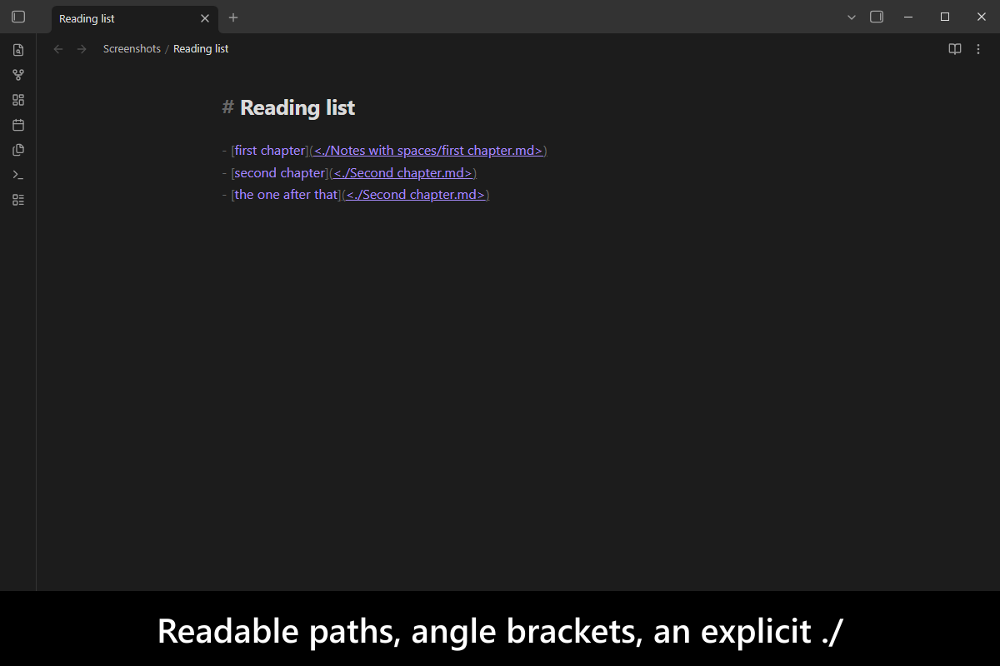
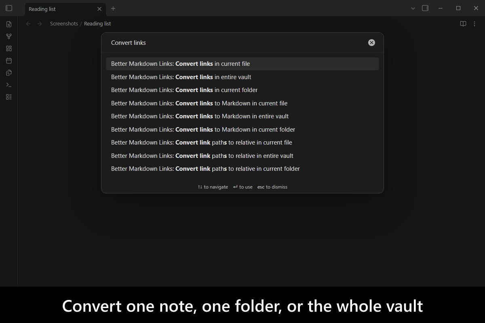
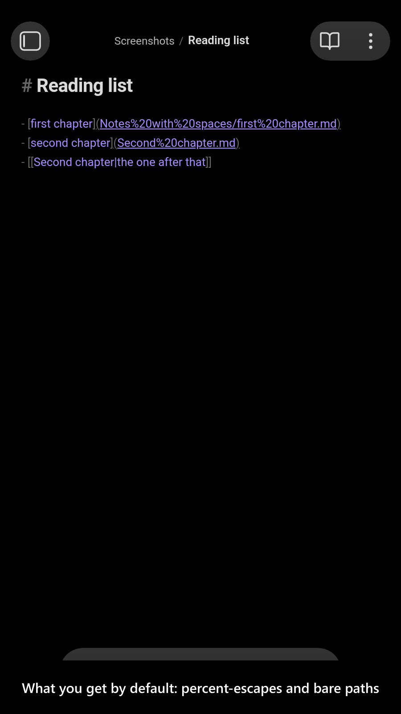
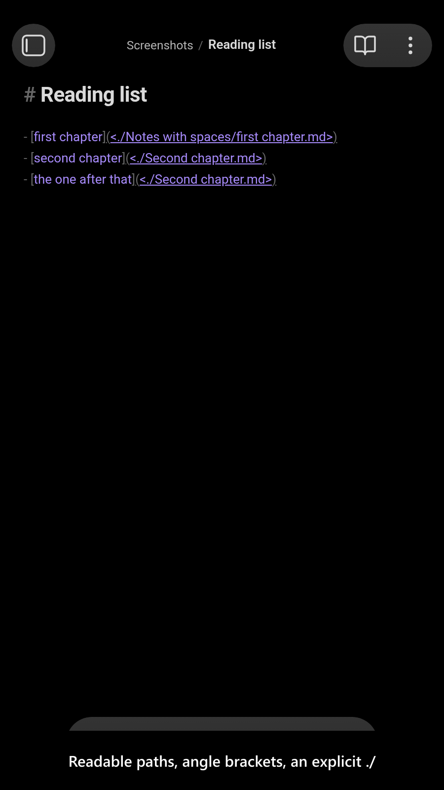
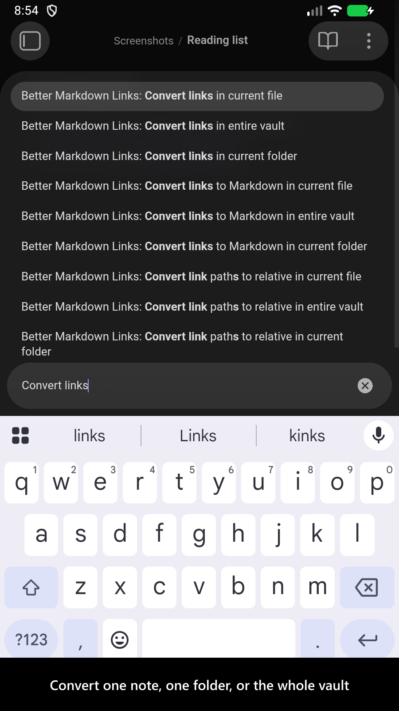

# Better Markdown Links

   

`[[Wikilinks]]` are not part of the Markdown spec, so a vault that uses them stops making sense outside [Obsidian]. Switch to Markdown links and you hit the next problem: Obsidian writes `[Title](path%20with%20space/note%20with%20space.md)`, which is unreadable, and it writes relative paths without a leading `./`, which other editors resolve differently than Obsidian does — the same link, two meanings.

This plugin makes Obsidian generate the readable, unambiguous form instead: angle brackets around paths with spaces, an explicit `./` on relative links, and tidy `file://` URLs. It can also convert the links you already have, in one note, one folder, or the whole vault — and decide for itself which style and which path form to write, rather than following Obsidian's own settings.

<!-- markdownlint-disable MD033 -->

More screenshots

<!-- markdownlint-enable MD033 -->

## Demo vault

**The documentation is a demo vault.** Every feature has a note that explains what it does and why you would want it, with awkward paths already in place to try it against.

**[Start reading here](<./demo-vault/00 Start.md>)** — it is plain markdown, so it works on GitHub with nothing installed.

A copy of the vault ships with every release. You can access it via any of the following:

1. Running the **`Better Markdown Links`: Open demo vault** command.
2. Downloading `better-markdown-links-demo-vault.zip` from the [Releases](https://github.com/mnaoumov/obsidian-better-markdown-links/releases). It unzips into a single `better-markdown-links-demo-vault-<version>` folder.
3. Browsing its source in [`demo-vault/`](./demo-vault/README.md) in this repository.

## What it does

- **Angle bracket links** — `[Title](<path with space/note.md>)` instead of `%20` noise: [01 Angle bracket links](<./demo-vault/01 Angle bracket links.md>).
- **Explicit relative links** — a leading `./`, so a relative path cannot be mistaken for an absolute one: [02 Relative links](<./demo-vault/02 Relative links.md>).
- **Convert what you already have** — a selection, a note, a folder or the whole vault, on command or automatically as you save: [03 Convert links](<./demo-vault/03 Convert links.md>).
- **`file://` normalization** — escaped backslashes in a `file://` link become plain forward slashes: [03 Convert links](<./demo-vault/03 Convert links.md>).
- **Force Markdown links** — whatever Obsidian's **Use `[[Wikilinks]]`** setting says, permanently or for one run: [03 Convert links](<./demo-vault/03 Convert links.md>).
- **Force a link path style** — relative, shortest or vault-absolute, whatever Obsidian's **New link format** setting says: [03 Convert links](<./demo-vault/03 Convert links.md>).
- **Demote embeds to links** — strip the `!` off every embed in a selection, a note, a folder or the vault: [04 Demote embeds](<./demo-vault/04 Demote embeds.md>).
- **Links that do not resolve** — point an alias-only wikilink at the note carrying the alias, or create the note: [03 Convert links](<./demo-vault/03 Convert links.md>).

## Integration with other plugins

- Since **5.0.0**, renames and deletes are handled by [`Advanced Rename and Delete Handler`](https://community.obsidian.md/plugins/advanced-rename-and-delete-handler), which this plugin offers to install: [05 Settings](<./demo-vault/05 Settings.md>).
- [`Backlink Cache`](https://community.obsidian.md/plugins/backlink-cache) speeds this plugin up on a large vault.
- [`Advanced Metadata Cache`](https://github.com/mnaoumov/obsidian-advanced-metadata-cache), with its **Names** module on, speeds up resolving links via aliases: [03 Convert links](<./demo-vault/03 Convert links.md>).

## Similar plugins

- [`Link Converter`](https://community.obsidian.md/plugins/obsidian-link-converter) — converts the links in one note or the whole vault to wikilinks or Markdown, and their paths to relative, absolute or shortest, on command; this plugin also writes angle brackets and a leading `./`, converts a selection or a folder, and can convert automatically as you save.
- [`Update Relative Links`](https://community.obsidian.md/plugins/update-relative-links) — keeps relative Markdown link paths correct when a note moves, and can rewrite every link to a relative path; this plugin leaves moves to Obsidian or to `Advanced Rename and Delete Handler`, and also offers the other path styles and angle brackets.
- [`Wikilinks to MDLinks`](https://community.obsidian.md/plugins/wikilinks-to-mdlinks-obsidian) — toggles the one link under the cursor between wikilink and Markdown form, in both directions; this plugin converts a whole selection, note, folder or vault to one style.
- [`Markdown Link Space Encoder`](https://community.obsidian.md/plugins/markdown-link-space-encoder) — encodes the spaces in the selected text as `%20`; this plugin keeps the spaces and wraps the path in angle brackets instead, in every link it writes or converts.
- [`Better Relative Wikilinks`](https://community.obsidian.md/plugins/better-relative-wikilinks) — writes a new wikilink with a relative path only when its name is ambiguous, keeping the bare name otherwise; this plugin applies one path style to every link, Markdown links included.
- [`Alias Linker`](https://community.obsidian.md/plugins/alias-linker) — makes a bare `[[alias]]` open the note that carries the alias, without changing the note, picking the nearest note when several carry it; this plugin rewrites such a link to point at the note, on an explicit convert, and only when exactly one note carries the name.
- [`Logseq Style Alias`](https://community.obsidian.md/plugins/logseq-style-alias) — makes a bare `[[alias]]` open the note that carries the alias, without changing the note, and can clean up empty notes created by such links; this plugin rewrites such a link to point at the note, on an explicit convert, and can create the note when nothing matches.
- [`Embed Link Converter`](https://community.obsidian.md/plugins/embed-link-converter) — converts image embeds between wikilink and Markdown syntax in both directions, with a preview and backups, and never rewrites a path; this plugin converts every link's style and path, and demotes embeds to plain links rather than changing their syntax.

Last searched for similar plugins on 2026-10-26.

## For plugin developers

This plugin publishes an API, `generateMarkdownLinkExtended()`, through the [`@mnaoumov/obsidian-lib`](https://www.npmjs.com/package/@mnaoumov/obsidian-lib) plugin registry under the id `better-markdown-links`, for a plugin that wants to write the same links without re-implementing them. Copy [`api.d.ts`](./api.d.ts) and [`api-contract.ts`](./api-contract.ts) into your plugin.

Usage, the contract, versioning, and moving over from the pre-6.0.0 `generateMarkdownLink.extended()`: [Plugin API](./docs/plugin-api.md).

## Installation

The plugin is available in [the official Community Plugins repository](https://community.obsidian.md/plugins/better-markdown-links).

### Beta versions

To install the latest beta release of this plugin (regardless if it is available in [the official Community Plugins repository](https://community.obsidian.md) or not), follow these steps:

1. Ensure you have the [BRAT plugin](https://community.obsidian.md/plugins/obsidian42-brat) installed and enabled.
2. Click [Install via BRAT](https://intradeus.github.io/http-protocol-redirector?r=obsidian://brat?plugin=https://github.com/mnaoumov/obsidian-better-markdown-links).
3. An Obsidian pop-up window should appear. In the window, click the `Add plugin` button once and wait a few seconds for the plugin to install.

## Debugging

By default, debug messages for this plugin (id: `better-markdown-links`) are hidden.

If you need to enable them refer to the [documentation](https://mnaoumov.dev/obsidian-lib/guides/debugging/).

## Changelog

All notable changes to this project will be documented in the [CHANGELOG](./CHANGELOG.md).

## Contributing

Contributions are welcome — see [CONTRIBUTING](./CONTRIBUTING.md) to get set up.

## Support

<!-- markdownlint-disable MD033 -->

<!-- markdownlint-enable MD033 -->

## My other Obsidian resources

[See my other Obsidian resources](https://github.com/mnaoumov/obsidian-resources).

## License

© [Michael Naumov](https://github.com/mnaoumov/)

[Obsidian]: https://obsidian.md/
